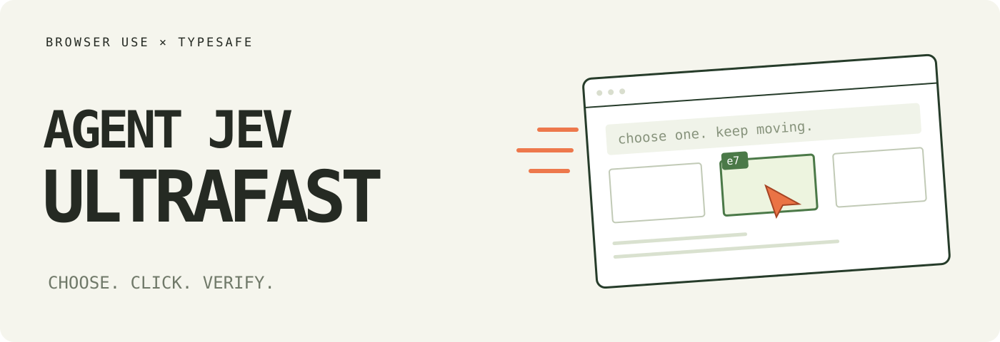

# Jev Ultrafast ⚡

> [!IMPORTANT]
> **The Browser Use Cloud waitlist is open.** Get early access to ultrafast browser agents in the cloud.
> **[Join the waitlist →](https://browser-use.com/ultrafast?utm_source=github&utm_medium=readme&utm_campaign=jev-ultrafast)**

**A browser agent with a dynamic, indexed action space.**

Give it one goal. [TypeSafe's Jev](https://docs.typesafe.ai/introduction) picks an operation and an element. A small LLM writes text only when the operation is `TYPE_TEXT`.

**Zürich → London on Google Flights in 7.1 seconds.** One natural-language goal, actual text generation, and loading waits included.

<a href="docs/demo.mp4"></a>

[Watch the MP4](docs/demo.mp4) · [Measurements](docs/performance.md) · [Read the loop](jev_ultrafast/agent.py)

## The action space

Every observation produces a new element table:

```text
[1] button    Change ticket type · Round trip
[2] combobox  Where from?        · San Francisco
[3] combobox  Where to?          · empty
[4] textbox   Departure          · empty
...
```

The operations are `CLICK`, `TYPE_TEXT`, `SELECT`, `SCROLL_UP`, `SCROLL_DOWN`, `WAIT`, `REOBSERVE`, `ABSTAIN`, `DONE`, and `BLOCKED`. Only supported operations and targets are offered, and `REOBSERVE` is withdrawn after its per-run budget.

```text
                      one TypeSafe request
                     ┌───────────────────────────┐
page → element table → operation                 │
                     │ click_target              │
                     │ type_text_target          │
                     │ select_target, if present │
                     └─────────────┬─────────────┘
                         use the matching target
                                   │
                    CLICK [7] ─────┤──→ browser
                TYPE_TEXT [3] ─────┘
                          ↓
                   small LLM → text → browser
```

Target questions are speculative. If the operation is `CLICK`, only `click_target` can execute. Two decisions, **one network round trip**. Each target head contains only compatible elements. Native dropdown choices carry an observed element/option index.

There are no site-specific action scripts or prepared field strings in the policy. The Flights example supplies a goal and independently verifies the outcome. The screenshot renderer adds labels afterward; it does not drive the browser.

## Try it

```bash
git clone https://github.com/browser-use/jev-ultrafast.git
cd jev-ultrafast
uv sync
cp .env.example .env
# Add TYPESAFE_API_KEY and TEXT_MODEL_API_KEY.
uv run jev
```

Open **http://127.0.0.1:8766** and click **Start demo → Run automatically**. The inspector shows numbered elements, operation probabilities, target probabilities, and executed actions. **Choose next** pauses before execution.

Chrome connects through [Browser Harness](https://github.com/browser-use/browser-harness), installed by `uv sync`. Run `uv run browser-harness --doctor` if it needs connecting. Allow remote debugging in Chrome when prompted.

`TEXT_MODEL_API_KEY` is the key for the text helper. The current configuration runs `deepseek-v4.1-flash` through the OpenAI-compatible OpenCode Go endpoint with reasoning disabled (`TEXT_MODEL`, `TEXT_MODEL_BASE_URL`, `TEXT_MODEL_REASONING` in `.env`). Gemini, GLM, DeepSeek and other OpenAI-compatible providers work too; configure the model, endpoint, and reasoning setting together. The 7.073 s recording used `inception/mercury-2.5`, so its helper latencies are historical rather than a property of the current configuration.

## Use the library

```python
from jev_ultrafast import Agent

with Agent(
    "https://www.google.com/travel/flights?hl=en",
    "Find one-way flights from Zurich to London on September 20, 2026, "
    "for one adult in economy. Stop when matching flight options are visible.",
) as agent:
    for state in agent.run():
        print(state["elapsed_ms"], state["status"])
```

Run with `uv run --env-file .env python your_script.py`. The same policy can run a different task:

```bash
uv run --env-file .env python examples/run.py \
  --url https://en.wikipedia.org/wiki/Main_Page \
  --goal 'Find and open the Wikipedia article about Gödel’s incompleteness theorems.'
```

`uv run --env-file .env python examples/flights.py --keep-open` performs the flight search, checks the actual route/date/results, and saves its trace. It does not select or book a flight.

## Why it moves

- **One request per decision cycle.** Operation and target heads share the same observed state.
- **No screenshots in the default agent loop.** Jev consumes structured state. The inspector opts into screenshots; the video uses a separate continuous screencast.
- **One browser call per snapshot.** Read visible controls, their names, values, and text atomically. Keep references to the actual DOM nodes.
- **Validate the selected target.** Clicks check the document, form values, target, and nearby context. Animation alone does not force another prediction. Resolve current geometry and reject covered controls before input.
- **Wait for useful state.** After typing into a combobox, wait for visible suggestions, capped at 200 ms. Other interactions get at most two animation frames or 50 ms. These reads happen after execution is logged.
- **Keep hidden tabs rendering.** Focus emulation prevents background animation throttling without switching Chrome's visible tab.
- **Send visible text.** Offscreen article bodies and footers do not fill the model context.
- **Reuse an interrupted text request.** A generated value survives a stale-page retry only if the entire text-helper input is unchanged.

Every executed target is resolved from an observed node. The executor rechecks page freshness and click occlusion. Model output never becomes selectors, coordinates, shell commands, or executable JavaScript. Text-helper output must parse as a small JSON object before typing.

## Verified outcomes, not opinions

`status` is what the agent did: `done`, `blocked`, `stalled`, or `abstained` (a collect-strategy run passes through `collecting`). `outcome` is the code-owned verdict, resolved from an independent readback:

| outcome | meaning |
| --- | --- |
| `verified` | an `expect` assertion ran against the real page and matched |
| `refuted` | a readback ran and did not match |
| `unknown` | nothing to verify against — a `DONE` choice alone is not proof |
| `abstained` | a risk gate refused to act |
| `budget_exhausted` | the anti-loop deadline or a step/time budget fired |

Pass `expect` (`url_contains`, `url_matches`, `title_contains`, `text_contains`, `text_absent`, `selector_count`, `value_contains` for an input's value, `harvest_at_least` for collected items) to `browser_do`, `run_task.py --expect` or `Agent(expect=...)` to get a verdict. Without one, a completed run reports `unknown`, never `verified`.

Three v2 properties go with it: a low-confidence mutation is re-observed once and then refused rather than executed (per-risk confidence floors, with an `irreversible` question riding the same request); repeated decisions are served from a disk cache keyed on the entire request; and a run can write append-only JSONL evidence — offered candidates, raw answers, confidences, the answering model, executions, outcome.

## Delegate a browser goal from another agent

The MCP server offers `browser_task(goal, url, expect?, mode?)`. It returns a task ID
and a checkpoint when the browser needs a human login, one-time code, CAPTCHA,
or approval for a consequential click. After the human finishes in the same
Chrome tab, call `browser_task_resume(task_id, checkpoint)`. If the result
proposes a publish, purchase, deletion, account-security, or other submit
action, show that exact proposed action to the human; only call resume with
`approve_action=true` after they approve it. Use `browser_task_cancel` to close
a yielded task. Every checkpoint is single-use: a changed page requires a new
prediction and another approval. A task ID expires after 30 minutes of waiting
or when the MCP server restarts.

This is a single-process, single-task delegation interface. Active work runs
in bounded slices and the result distinguishes `paused`, `needs_human`,
`complete`, `cancelled`, and `abandoned`. A pause is not success. Only the
independent `expect` readback can produce `verified`; an uncertain dispatched
action stops the task with `unknown` rather than repeating it. Login and
approval signals are based on visible DOM controls and labels, so callers must
still review the proposed action. Descriptor replay and screenshot-based
recovery are disabled for delegated tasks while they lack per-step approval
preflight. New-tab journeys are not yet supported by this task interface.

Delegated tasks can fill exact, unique field labels from the local profile at
`~/.jev-ultrafast/profile/`. The first profile fill on a web origin yields a
`confirm_fill` checkpoint; subsequent fills on that origin use the recorded
approval. [Profile setup and privacy limits](docs/profile.md) explain the JSON
format. The profile stores no passwords or payment details; type those into
Chrome yourself. A Windows DPAPI vault is a separate future feature.

## Modes: memory and specialists per task class

A mode is a folder for one repeated kind of work — internship applications, scrolling a feed — with its own memory, learned field values and settings. The agent gets that context before it decides anything:

```bash
# Match an existing mode by keyword, or let the text model create one for a durable task.
uv run --env-file .env python run_task.py --mode auto --goal "..." --url https://x.com/home

# Manage the memory of a mode you own.
uv run --env-file .env python run_task.py --mode internship-application --remember "Name: Ada Lovelace"
uv run --env-file .env python run_task.py --mode internship-application --forget "Email"
```

- Folders live in `JEV_MODES_DIR` (default `~/.jev-ultrafast/modes`, outside git). Each holds `mode.json`, a human-editable `AGENTS.md` (about me / standing instructions / interests), `learned/` field values, `harvest/` collected items and `replay/` plans.
- `--mode auto` (or `JEV_MODES=auto`) matches existing modes by keyword; only a durable task class gets a new folder, and creation is printed, recorded in evidence and named in the mode's own file. One-off errands stay mode-less.
- A fill with an exact label and web-origin match in learned memory is typed with no model call. Caller-supplied `values` outrank memory. Learned literals stay out of model prompts.
- Sensitive labels (password, passcode, OTP, card, CVV, SSN, passport, IBAN, bank, national insurance, routing/sort code, PIN) are never learned, never injected into a prompt, and never persisted in a replay plan.
- A collect-strategy mode scrolls and harvests only — it never clicks anything — and stores an item only if its title appears verbatim in the page text. Live results for the internship, local-feed and real-x.com scenarios are in [docs/modes-scenarios.json](docs/modes-scenarios.json).

## Small enough to read

| File | Job |
| --- | --- |
| [agent.py](jev_ultrafast/agent.py) | The complete loop and text-helper handoff |
| [snapshot.js](jev_ultrafast/snapshot.js) | Atomic DOM snapshot, indexed controls, freshness guards |
| [browser.py](jev_ultrafast/browser.py) | Browser connection, current geometry, execution |
| [model.py](jev_ultrafast/model.py) | Dynamic operation/target heads and text generation |
| [questions.py](jev_ultrafast/questions.py) | Model instructions |
| [outcomes.py](jev_ultrafast/outcomes.py) | Code-owned outcome vocabulary |
| [assertions.py](jev_ultrafast/assertions.py) | Readback assertions and page facts |
| [gates.py](jev_ultrafast/gates.py) | Per-risk confidence gates |
| [cache.py](jev_ultrafast/cache.py) | Decision cache keyed on the full request |
| [evidence.py](jev_ultrafast/evidence.py) | Append-only run evidence |
| [demo.py](jev_ultrafast/demo.py) | Local inspector |

## Evidence and limits

The current video is a **7,073 ms** Google Flights run. Timing starts after initial page observation and includes model calls, generated text, browser work, stale decisions, and loading waits. A fresh independent check verifies the one-way setting, Zürich, London, September 20, 2026, and visible flight options. The video plays at 1×, with no opening hold and a 0.5-second final hold.

In six alternating runs with identical models and settings, both versions passed **3/3**. Median task time went from **9.450 s → 7.092 s**, a **25% reduction**; median browser protocol calls went from **1,092 → 101**. This is three repeats of one task on one browser profile, not a general reliability benchmark. Both figures predate the v2 outcome/gate layer, and the recorded task date (Sunday, September 20, 2026) has since passed, so the matched comparison cannot be re-run as published; [performance.md](docs/performance.md) documents what was re-measured instead.

The same policy opened the requested Wikipedia article in **2.798 s** and passed a local hotel search/filter task in **1.896 s**. Runs, failures, source hashes, and measurement boundaries are in [performance.md](docs/performance.md).

A `DONE` choice still requires independent outcome verification. The DOM reader handles common HTML and ARIA controls, not the full accessible-name specification. Shadow roots, frames, canvas, uploads, pop-up tabs, nested scrolling, and arbitrary keyboard widgets remain outside this MVP. Owned tabs share the existing Chrome profile.

## Development

```bash
uv run ruff check .
uv run pytest
node --check jev_ultrafast/static/app.js
node --check jev_ultrafast/snapshot.js
uv build
```

Tests are offline. `uv run python scripts/check_guards.py` checks real controls in a local browser without model calls. Live examples and recording scripts make paid API calls. `scripts/record_flights.py <new-folder>` captures original browser timestamps; `scripts/render_demo.py <recording-folder>` renders that verified run at 1× and crops out the Google account strip. Credentials and raw traces stay ignored.

---

[Browser Use](https://github.com/browser-use/browser-use) · [Browser Harness](https://github.com/browser-use/browser-harness) · [TypeSafe speculative fan-out](https://docs.typesafe.ai/patterns/fan-out)
