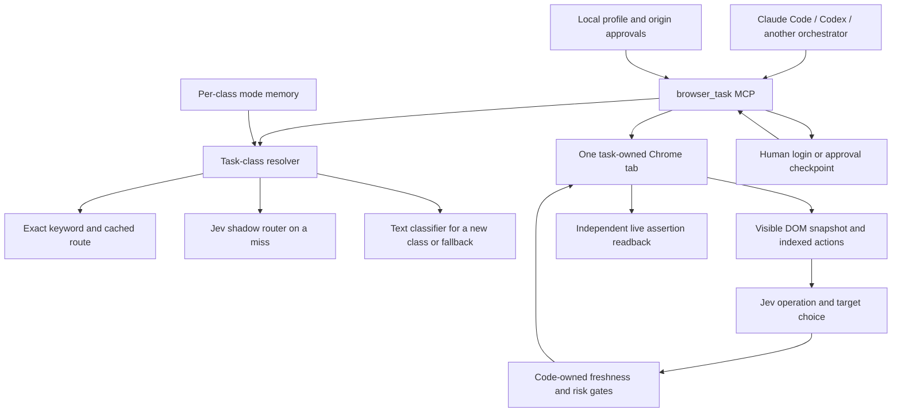

# AgentJevUltraFast architecture

## Goal and boundary

An orchestrating agent gives the browser one natural-language goal, optional
field values, and independent success assertions. AgentJevUltraFast turns a
fresh page snapshot into numbered actions, asks Jev for one operation and its
compatible target in one request, executes only observed actions, and verifies
the result through a separate live readback. The orchestrator can save its own
tokens and browser round trips by delegating a bounded segment, then resuming
the same tab after a human login or approval.

The Browser object, Agent, checkpoint, and task ID live in one MCP server
process. A task owns one tab. `browser_task_resume` reobserves that same tab;
it does not replay the goal or navigate to the start URL again. A server
restart invalidates the task ID. Active slices have an execution budget;
waiting at a human checkpoint does not consume that active budget. A stalled
page still has a short no-progress deadline during active work. A timed-out
worker fences new browser work until it exits, because its last mutation may
have reached Chrome even if no reply arrived.

## Data and model boundaries

- Jev selects only from code-built operations and current page action IDs.
  Its output cannot become a selector, coordinate, shell command, or script.
- A separate small text model writes field text only when the chosen action
  needs text and neither caller data, approved profile data, replay, nor exact
  origin-scoped learned memory supplies it.
- Local mode memory is user-editable and can be included in model prompts.
  Learned literals are origin-scoped and resolved locally; they are not sent
  as a bundle to the text helper. A mode with a colliding slug fails rather
  than inheriting another class's memory. New mode metadata stores a hash of
  the triggering goal, not the goal itself.
- Profile fields live as plaintext outside Git at
  `~/.jev-ultrafast/profile/`. A first fill on each origin pauses. Password,
  one-time-code, payment, and recovery fields are never read from the profile.
  Known fill literals are masked in Chrome's snapshot before the page object
  reaches Python. Returned traces omit the literal, and screenshot recovery
  and recording stop once a private fill is present.
- The page receives any text typed into it. Literal masking cannot recognise
  a site that transforms or splits an echoed value; the profile is data
  minimization rather than a secret vault. A Windows DPAPI vault is deferred.

## Outcome and approval

`status` describes what the agent did. `outcome=verified` requires a live
`expect` assertion; `DONE` is not proof. Readback failure yields `unknown`.
The readback collects URL, title, text, selected values, and selector counts
in one JavaScript evaluation so route changes cannot combine facts from two
different page states. A harvest count alone cannot verify a page.

Publishing, purchasing, deleting, changing account security, form submission,
and other consequential labels yield `needs_human` before the action in the
delegated interface. The MCP caller must present the proposed action to the
user and set `approve_action=true` only after the user agrees. This is a
**caller-mediated approval contract**: a tool caller with full API access can
set that boolean itself. The code cannot authenticate who answered. The
manual demo script obtains a terminal confirmation from the user. Approval is
bound to a checkpoint and a page fingerprint; if the page changed while the
user waited, it is discarded and a new prediction is required. Browser labels
and Jev risk scores can miss an obscure or unlabeled consequential control,
so use a trusted orchestrator and inspect live actions for sensitive work.

## What is implemented and what is pending

| Capability | Current state |
| --- | --- |
| Bounded same-process task, pause/resume/cancel, same-tab login | Implemented and offline-tested |
| Atomic independent assertions, no mutation transport retry | Implemented and offline-tested |
| Local exact-label profile with origin approval | Implemented and offline-tested; no personal data included |
| Learned-value origin scope and verified-only replay | Implemented and offline-tested |
| Jev mode router | Shadow by default; enforcement requires independent labels |
| Real Chrome end-to-end delegation demo | Scripted; live verification pending |
| Checkout folder rename to `AgentJevUltraFast` | Run `scripts/migrate_folder.ps1` with every agent closed |
| Resume after server restart, OAuth popup/new-tab journeys | Pending |
| Shadow DOM, iframe controls, native passkey dialogs | Pending |
| Windows DPAPI secret vault | Separate later feature |
| Cold/warm delegated runs on a local fixture | Measured (docs/performance.md); v2 and orchestrator-tool comparison still pending |

The older Flights video and timing remain historical evidence for the original
loop. They are not evidence that the new delegation path has the same latency.
